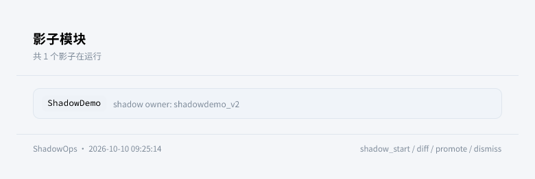
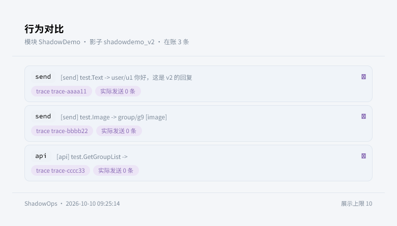
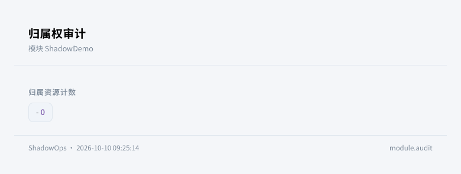

<div align="center">


# ErisPulse ShadowOps

**影子灰度管理模块 —— 在聊天中启动、对比、转正、放弃影子模块。**

基于 ErisPulse 2.9 影子模块运行时 API 的运营工具，附归属权审计，报告经 Takumi 渲染为卡片。

<p>
  <a href="https://pypi.org/project/ErisPulse-ShadowOps/"></a>
  <a href="https://pypi.org/project/ErisPulse-ShadowOps/"></a>
  <a href="./LICENSE"></a>
  <a href="https://github.com/ErisPulse/ErisPulse-ShadowOps"></a>
  <a href="https://pepy.tech/project/ErisPulse-ShadowOps"></a>
  <a href="https://github.com/ErisPulse/ErisPulse"></a>
</p>

<p>
  <a href="./README.md">简体中文</a> | <a href="./README.en.md">English</a>
</p>

</div>

---

## 简介

ShadowOps 是基于 [ErisPulse](https://github.com/ErisPulse/ErisPulse/) 架构开发的影子灰度运营模块。影子 = 同一模块的新版本，以独立 owner 与线上旧版并存试运行：收到真实事件副本、出站被拦截记账而非真正发出。本模块把这些运行时操作暴露为聊天命令：

- `shadow start`：把 v2 代码目录装载为影子
- `shadow diff`：对比 v1 实际发送 × v2 意向发送（按 trace_id 对齐）
- `shadow promote`：确认后一键转正（失败自动回滚）
- `shadow dismiss`：放弃影子
- `shadow audit`：归属权审计（资源计数 / 孤儿 owner）

要求 ErisPulse >= 2.9.0。

---

## 效果展示

| `/shadow list` | `/shadow diff` | `/shadow audit` |
|:---:|:---:|:---:|
|  |  |  |

---


---

## 安装

```bash
epsdk install ErisPulse-ShadowOps
```

---

## 命令

| 命令 | 说明 |
|------|------|
| `/shadow` | 显示用法 |
| `/shadow start <模块名> <v2路径>` | 启动影子（v2 代码目录或单 .py 文件，建议放在插件目录之外） |
| `/shadow list` | 列出运行中的影子 |
| `/shadow diff <模块名>` | 行为对比报告 |
| `/shadow promote <模块名> yes` | 转正（必须带 `yes` 确认） |
| `/shadow dismiss <模块名>` | 放弃影子 |
| `/shadow audit <模块名>` | 归属权审计 |

全部命令需要框架主人权限。

---

## 使用示例

```bash
# 1. 把新版代码放到服务器任意目录（如 downloads/roll_v2/）

# 2. 启动灰度
/shadow start roll downloads/roll_v2

# 3. 试运行一段时间后对比行为
/shadow diff roll

# 4. 确认无害后转正（失败自动回滚旧版本）
/shadow promote roll yes

# 或放弃
/shadow dismiss roll
```

---

## 配置说明

```toml
[ShadowOps]
diff_max_rows = 10      # 对比报告单次展示条目数
audit_deep = false      # 审计附带 gc 实例普查（有全局暂停开销）
render_card = true      # 报告用 Takumi 渲染为卡片
theme = "doodle"          # 卡片风格 (doodle/editorial)
```

| 配置项 | 类型 | 默认值 | 说明 |
|--------|------|--------|------|
| `diff_max_rows` | int | `10` | 对比报告条目上限 |
| `audit_deep` | bool | `false` | gc 实例普查 |
| `render_card` | bool | `true` | 卡片渲染 |
| `theme` | str | `doodle` | 卡片风格 (doodle/editorial) |

---

## 注意事项

1. 影子源为本地路径；同一 PyPI 包无法在同解释器内新旧并存
2. promote 是运行时切换，重启后需持久化安装新版本（`pip install -U`）
3. 走框架的发送/API/KV 全部拦得住；绕过框架的副作用不可拦截（audit 可见资源归属）

---

## 参考链接

- [ErisPulse 主库](https://github.com/ErisPulse/ErisPulse/)
- [影子模块文档](https://github.com/ErisPulse/ErisPulse/tree/main/docs/zh-CN/advanced/shadow.md)
